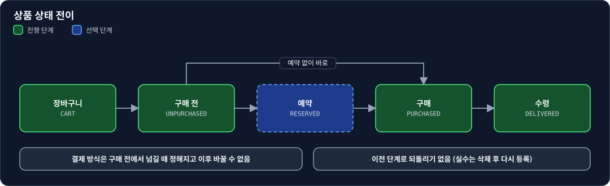
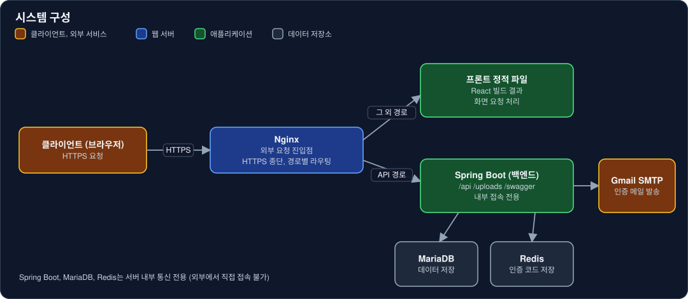
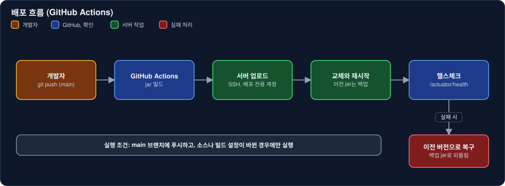

# miku-miku-reservation-backend

예약 구매하는 굿즈의 구매 내역을 기록하고 관리하는 서비스의 백엔드 REST API


- 서비스: https://miku-miku-reservation.com
- API 문서: https://miku-miku-reservation.com/swagger-ui.html

## 목차

- [소개](#소개)
- [주요 기능](#주요-기능)
- [기술 스택](#기술-스택)
- [시스템 구성](#시스템-구성)
- [폴더 구조](#폴더-구조)
- [API 문서](#api-문서)
- [배포](#배포)
- [관련 저장소](#관련-저장소)

## 소개

예약 구매하는 굿즈(피규어 등)를 한곳에 모아 기록하는 장부입니다.
상품마다 어디서, 얼마에, 어떤 방식으로 샀는지와 지금 어느 단계인지를 남깁니다.

상품은 아래 순서로 넘어갑니다.



## 주요 기능

| 구분 | 내용 |
|---|---|
| 상품 관리 | 등록, 수정, 삭제, 목록과 상세 조회, 상태 전이(단건, 일괄) |
| 분류 관리 | 판매처, 형태, 시리즈, 장르와 캐릭터, 제조사를 상위 분류와 하위 분류로 관리 |
| 이미지 | 설명 에디터 이미지와 썸네일 업로드, 사용하지 않는 이미지 자동 정리 |
| 계정 | 이메일 인증 가입, 로그인, 아이디 찾기, 비밀번호 재설정과 변경, 탈퇴 |

## 기술 스택

| 구분 | 사용 기술 |
|---|---|
| 언어, 프레임워크 | Java 17, Spring Boot 4.0.8, Gradle |
| 데이터 | MyBatis, MariaDB, Redis (이메일 인증 코드) |
| 인증 | Spring Security, JWT (jjwt) |
| 메일 | Gmail SMTP (HTML 메일 템플릿) |
| API 문서 | springdoc-openapi (Swagger UI) |
| 서버 | AWS Lightsail (Ubuntu), Nginx, Let's Encrypt |
| 배포 | GitHub Actions |

## 시스템 구성



## 폴더 구조

레이어(`controller`, `service`, `mapper`, `vo`) 아래에 도메인 폴더를 둡니다.

```
src/main/java/com/jong/mikumikureservationbackend
├── common      공통 응답, 예외 처리, 상수, 스케줄러
├── config      보안, CORS, Swagger, 설정 값
├── controller  API 엔드포인트 (auth, figure, shop, series ...)
├── service     비즈니스 로직 (인터페이스 + impl)
├── mapper      MyBatis 매퍼 인터페이스
└── vo          요청, 응답, 테이블 객체

src/main/resources
├── mapper      MyBatis SQL (XML)
└── mail        메일 HTML 템플릿
```

## API 문서

엔드포인트별 경로, 요청, 응답, 오류는 Swagger에서 확인합니다.

- https://miku-miku-reservation.com/swagger-ui.html

문서 화면은 별도 계정(Basic 인증)으로 열립니다. API는 가입과 로그인 등 일부를 제외하고 `Authorization: Bearer` 토큰이 필요합니다.

## 배포

`main` 브랜치에 푸시하면 GitHub Actions가 자동으로 배포합니다.



1. 소스나 빌드 설정(`src/**`, `build.gradle`)이 바뀐 푸시에만 실행
2. jar를 빌드해서 서버에 업로드
3. 이전 jar를 백업하고 새 jar로 교체한 뒤 서비스 재시작
4. `/actuator/health`가 `UP`이 될 때까지 확인
5. 실패하면 백업한 이전 jar로 되돌림

## 관련 저장소

| 저장소 | 설명 |
|---|---|
| [miku-miku-reservation-frontend](https://github.com/jongHyeon0000/miku-miku-reservation-frontend) | React + TypeScript 프론트엔드 |
